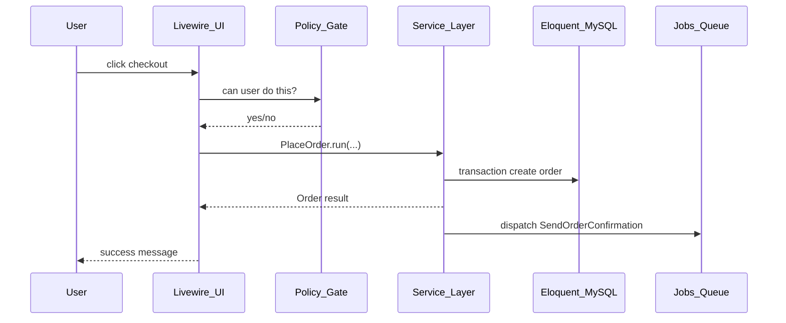

# FoodHub — Laravel 12 + Livewire 3 roadmap

**Purpose:** CV-ready single-restaurant app (Option A) while learning concepts expected at ~3 years backend experience.

**How to use this doc:** Follow phases in order. When we implement each phase in the IDE, we will **explain every new concept** (Breeze, policies, queues, etc.) in plain language at the moment you first use it. This file is your map and glossary.

**Reference project:** [AM-Plus-Diagnostics](../AM-Plus-Diagnostics) — same ideas at larger scale (booking, cart, payments, admin Livewire, services, repositories).

---

## Where you are now

| Area | Current state |
|------|----------------|
| Routing | Full-page Livewire in `routes/web.php` |
| Domain | `Restaurant`, `Category`, `MenuItem` + migrations + `FoodHubSeeder` |
| Livewire | `MenuPage` (eager load + `whereHas`), `RestaurantSearch`, stub `AddToCart` |
| Gaps | No auth/admin, no real cart/orders/bookings, no services/policies/jobs/tests |

**Scope (CV v1):** One restaurant (“FoodHub Kitchen”), customer flow + admin panel. Multi-vendor marketplace is **future work** only.

---

## Architecture (how layers bind — like AM-Plus-Diagnostics)

AM-Plus-Diagnostics separates **who talks to the user**, **who runs business rules**, and **who talks to the database**. FoodHub uses the same pattern, simplified.

### Request flow (mental model)



### Layer responsibilities

| Layer | Folder (FoodHub) | Role | AM-Plus example |
|-------|------------------|------|-----------------|
| **UI** | `app/Livewire/`, `app/Livewire/Admin/` | Form state, validation messages, `wire:click`, pagination | `app/Livewire/Admin/DoctorBookings/BookingsTable.php` |
| **Authorization** | `app/Policies/`, middleware on routes | “Can this **user** perform this **action** on this **model**?” | AM often uses `FormRequest::authorize()` + middleware; FoodHub adds **Policies** for admin vs customer |
| **Application / domain** | `app/Services/Orders/`, `Booking/`, `Cart/` | One class per **use case**: place order, create booking, merge cart | `AppointmentConfirmationService`, `BookingCancellationService` |
| **Data access (optional)** | `app/Repositories/Contracts/`, `Repositories/Eloquent/` | Complex queries + pagination hidden behind an interface | `AppointmentRepository` + `RepositoryServiceProvider` bindings |
| **Persistence** | `app/Models/` | Tables, relationships, scopes, casts | `Appointment`, `Payment` |
| **Side effects** | `app/Events/`, `Listeners/`, `Jobs/`, `Notifications/` | Email after order, async work | `PushOpdBookingToXcelcure`, `AppointmentBookedNotification` |
| **Enums** | `app/Enums/` | Order status, booking status (typed, no magic strings) | `AppointmentStatus`, `PaymentStatus` |

### Services vs Repository — what FoodHub should use

| Pattern | What it is | When to use |
|---------|------------|-------------|
| **Service** | Class with methods like `placeOrder()`, `confirmBooking()` — orchestrates DB, validation, events | **Always** for writes and important reads (checkout, booking rules) |
| **Repository** | Interface + Eloquent class that encapsulates **queries** (`listForPatient`, filters, pagination) | When a query is **reused** or **heavy** (admin order table, order history filters). AM binds interfaces in `RepositoryServiceProvider`. |

**Recommendation for FoodHub (CV, not over-engineered):**

1. **Start with Services + Eloquent** inside those services (fast to learn).
2. Add **one repository** when you feel pain — e.g. `OrderRepository` for admin listing + customer history (mirror `AppointmentRepositoryInterface`).
3. Do **not** wrap every model in a repository; that adds noise without interview value.

**Rule you already know from AM:** Livewire/components stay **thin** — they call a service, they do not contain 80-line `DB::transaction` blocks.

### Target folder layout (end state)

```
app/
  Enums/OrderStatus.php
  Events/OrderPlaced.php
  Jobs/SendOrderConfirmation.php
  Listeners/SendOrderConfirmationEmail.php
  Livewire/              # public pages
  Livewire/Admin/        # dashboard, menu CRUD, orders, bookings
  Models/
  Policies/OrderPolicy.php, MenuItemPolicy.php
  Services/
    Cart/CartService.php
    Orders/PlaceOrderService.php
    Booking/CreateTableBookingService.php
  Repositories/          # add in Phase 6 if needed
    Contracts/Orders/OrderRepositoryInterface.php
    Eloquent/Orders/OrderRepository.php
  Providers/RepositoryServiceProvider.php   # only if using repos
```

Register repository bindings the same way as AM: `RepositoryServiceProvider` maps `OrderRepositoryInterface` → `OrderRepository`.

---

## Concept glossary (learn as we build)

Read this once; we will revisit when coding.

### Laravel Breeze

- **What:** Official starter kit that generates **login, register, password reset, profile** using Blade or **Livewire** stacks.
- **Why FoodHub:** Saves weeks of auth UI and wires session guard, routes, and views correctly.
- **What you get:** Routes like `/login`, `auth` middleware, email verification hooks, profile update.
- **Not the same as:** Full “admin template” — you still build FoodHub admin Livewire pages yourself.

### Authentication vs authorization

- **Authentication (auth):** *Who are you?* — login session, `auth` middleware, `Auth::user()`.
- **Authorization:** *What may you do?* — policies, gates, `authorize()`, `@can` in Blade.

### Policy (Laravel)

- **What:** A class per model (e.g. `OrderPolicy`) with methods: `view`, `update`, `delete`, or custom `manageMenu`.
- **Example rule:** Customer may `view` only their own `Order`; `admin` may `update` any order status.
- **Usage:** `$this->authorize('update', $order)` in Livewire; `OrderPolicy` runs before status change.
- **Not the same as:** AM’s `CancellationRefundPolicy` — that is a **domain rules** class (business logic), not Laravel’s `Policy` authorization. FoodHub will use **both**: Laravel `OrderPolicy` for access, service classes for refund/cancel rules if needed later.

### Middleware

- **What:** Pipeline before the request hits your page — e.g. `auth`, `verified`, `can:access-admin`.
- **FoodHub:** Wrap `/admin/*` in `auth` + role check so customers get 403.

### Form Request

- **What:** Class with `rules()` and sometimes `authorize()` for HTTP/API input.
- **FoodHub:** Livewire often uses `rules()` on the component; optional Form Requests for Sanctum API phase.

### Eloquent scopes

- **What:** Reusable query constraints on a model — `MenuItem::available()->forRestaurant($id)`.
- **Why:** Keeps Livewire `render()` readable; same filters in admin and public menu.

### `DB::transaction()`

- **What:** All DB writes in the block succeed together or roll back on exception.
- **FoodHub:** Creating `orders` + `order_items` + clearing cart must be atomic (like AM appointment booking in `AppointmentRepository::book`).

### Events, listeners, jobs, queues

- **Event:** “Something happened” — `OrderPlaced`.
- **Listener:** Reacts to event — dispatch a job or send mail.
- **Job:** Unit of async work — `SendOrderConfirmation` implements `ShouldQueue`.
- **Queue:** Worker processes jobs (`php artisan queue:listen` — your `composer dev` already includes this).
- **Why:** User does not wait for SMTP; failed jobs can retry.

### Notifications vs Mailables

- **Mailable:** One email template.
- **Notification:** Can use mail + database channels; good for “order confirmed” and future in-app alerts.

### Factories & seeders

- **Factory:** Fake model rows for tests (`MenuItem::factory()`).
- **Seeder:** Demo data for local/CV demo (`FoodHubSeeder`).

### Livewire 3 (essentials)

- Full-page components as routes (`Route::get('/menu', MenuPage::class)`).
- `wire:model.live` — update server on change (search/filter).
- `wire:click` — call component methods.
- Nested components + `$dispatch` — cart badge updates from `AddToCart`.
- `#[Layout('components.layouts.app')]` — shared layout.

### PHPUnit + Livewire testing

- **Feature test:** HTTP/Livewire flow end-to-end.
- **`Livewire::test(CartPage::class)`** — assert validation and outcomes.
- **`Queue::fake()` / `Mail::fake()`** — assert side effects without sending real email.

---

## CV recommendation (short)

Phases **1, 3, 5, 6, 8** are non-negotiable for CV impact: auth + policies, checkout, queue mail, admin, tests.

Optional: deploy + README demo logins; thin Sanctum API only if job ads mention API.

### Sample CV bullets (after build)

- FoodHub — restaurant ordering and table booking with **Laravel 12**, **Livewire 3**, **MySQL**; secured admin for menu and orders.
- **Policies**, transactional checkout with server-side price checks, **queued** order confirmations.
- **PHPUnit** / Livewire tests for checkout and unauthorized admin access.

---

## Phases (implementation order)

### Phase 0 — Hygiene (0.5–1 day)

- Nav/branding, `FoodHubSeeder` in `DatabaseSeeder`, factories, optional slug routes.
- **Concepts:** route names, model binding, seed workflow.

### Phase 1 — Auth (2–3 days)

- Install **Breeze (Livewire stack)**.
- Add `role`: `customer` | `admin`.
- Create **Policies**; admin route group.
- **Deliverable:** Customer cannot open `/admin`.

### Phase 2 — Menu (2–3 days)

- Filters, pagination, scopes; wire `AddToCart` to real `menu_item_id`.
- **Concepts:** N+1, `wire:model.live.debounce`, component events.

### Phase 3 — Cart & checkout (4–5 days)

- Tables: `orders`, `order_items`, cart storage (DB or session + merge on login).
- **`PlaceOrderService`** with `DB::transaction()`, price re-read from DB.
- **Concepts:** money as decimal, order status enum, domain vs UI validation.

### Phase 4 — Table booking (2–3 days)

- `table_bookings`; **`CreateTableBookingService`**; overlap validation.
- Admin confirm/cancel with **policy** checks.

### Phase 5 — Async (2 days)

- `OrderPlaced` → listener → **`SendOrderConfirmation`** job.
- **Concepts:** `QUEUE_CONNECTION=database`, failed jobs table.

### Phase 6 — Admin (4–5 days)

- CRUD menu (file uploads), order status, bookings dashboard.
- Optional **`OrderRepository`** for filtered lists (AM-style).
- **Concepts:** soft deletes, `Storage::disk('public')`.

### Phase 7 — Polish (1–2 days)

- Contact form + **RateLimiter**; cache menu; observer to clear cache.

### Phase 8 — Tests (3–4 days)

- Checkout, booking rules, policy 403, queue fakes.

### Phase 9 — CV extras (optional)

- Deploy, README, minimal Sanctum endpoints reusing `PlaceOrderService`.

---

## Timeline

| Week | Focus |
|------|--------|
| 1 | Phase 0–1 |
| 2 | Phase 2–3 |
| 3 | Phase 4–5 |
| 4 | Phase 6–8 |
| 5 | README, demo, optional deploy/API |

---

## First tasks when you start coding

1. Breeze Livewire + `role` + admin middleware.
2. Migrations for orders / order_items / cart.
3. `PlaceOrderService` + thin `CheckoutPage` Livewire.
4. One test: customer places order when item is available.

---

## Learning contract

For each new tool (Breeze, Policy, Job, Repository binding, etc.) during implementation:

1. **What it is** (one sentence)
2. **Where it lives** in FoodHub folders
3. **How it connects** to the layer above/below (see diagram)
4. **AM-Plus parallel** when one exists

Say **“start Phase 1”** or **“execute the plan”** in Agent mode when you are ready to build.
